# LeeGarUpdater — OTA JSON Feed & Integration Guide

**LeeGarUpdater** (`org.leegar.updater`) is a privileged Android system updater supporting multi-release feeds, rich project metadata, Markdown changelogs, split/multi-part archives with per-part and final SHA-256 verification, A/B streaming updates, and custom media/vector banners.

<details>
<summary>📸 Screenshots (tap to expand)</summary>

_Screenshots were taken on an Evolution X build before the LeeGarUpdater rebrand; the UI is identical._

| Updates tab | Release details | Split download |
| :---: | :---: | :---: |
| 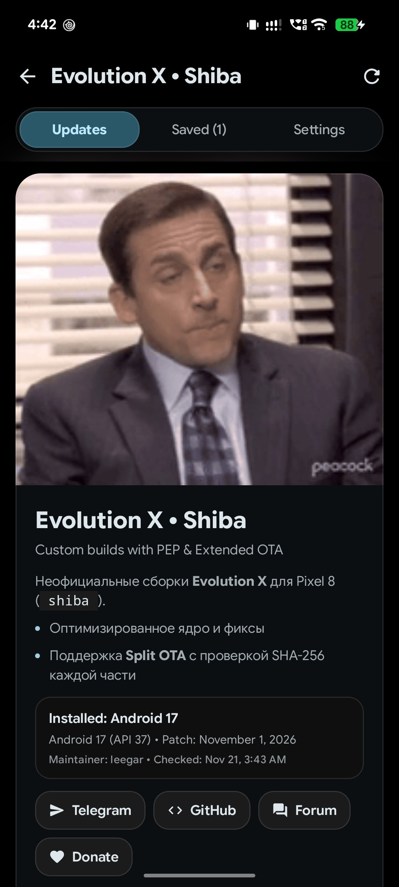 | 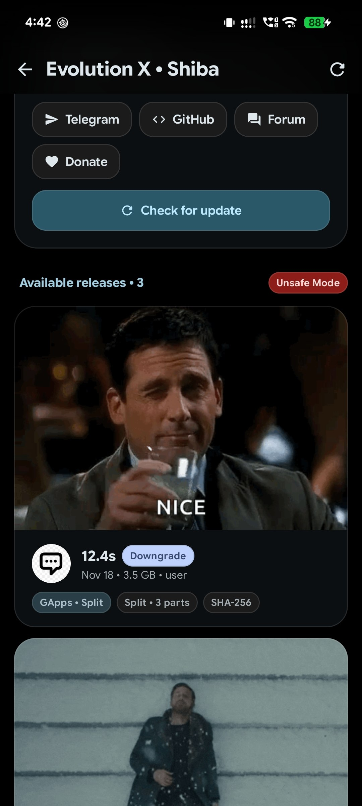 | 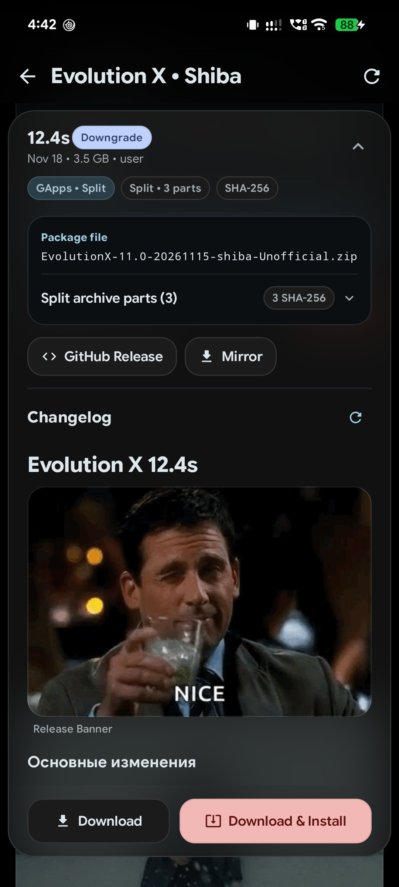 |
| Hero Card, tabs and release list | Expanded release card with banner, links and actions | Split archive parts with per-part SHA-256 |
| 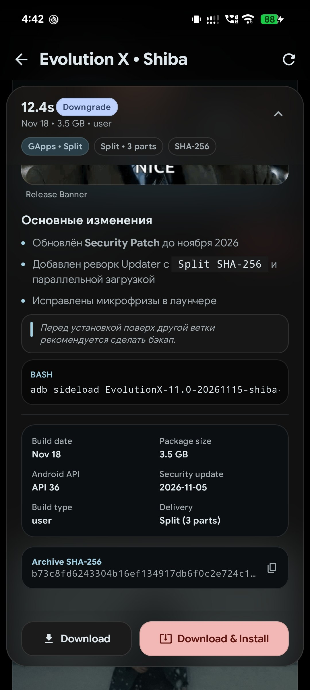 | 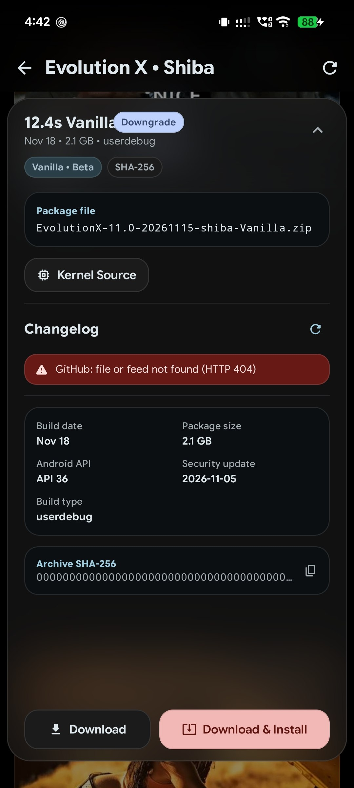 | 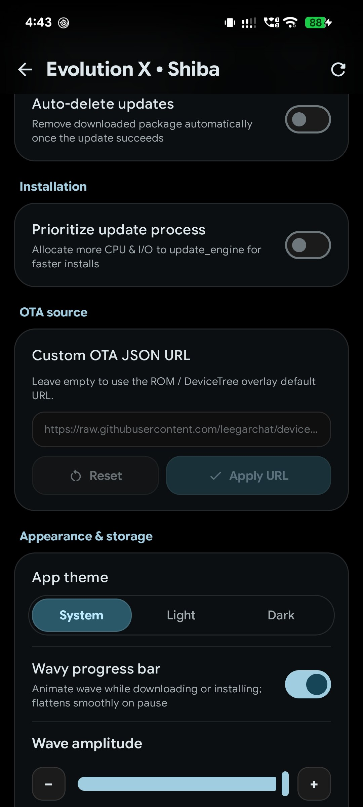 |
| Markdown changelog and build metadata | Release info, install actions, changelog fallback | Settings: OTA source, custom URL, appearance |
| 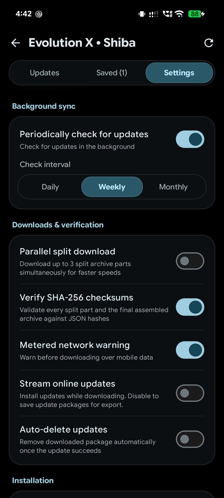 | 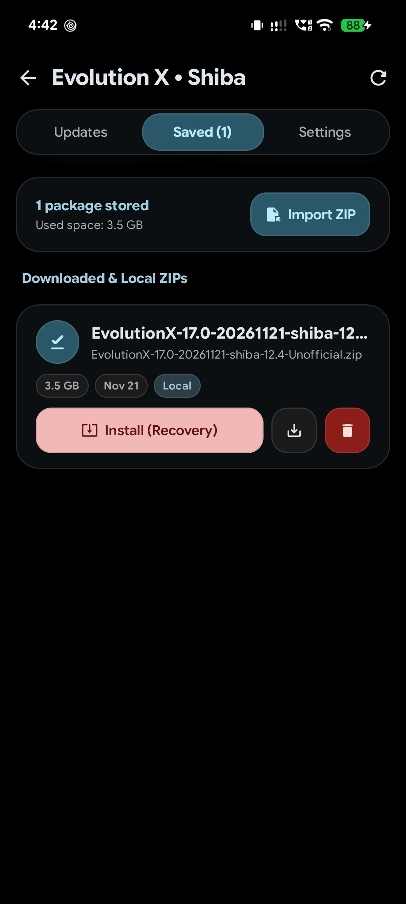 | 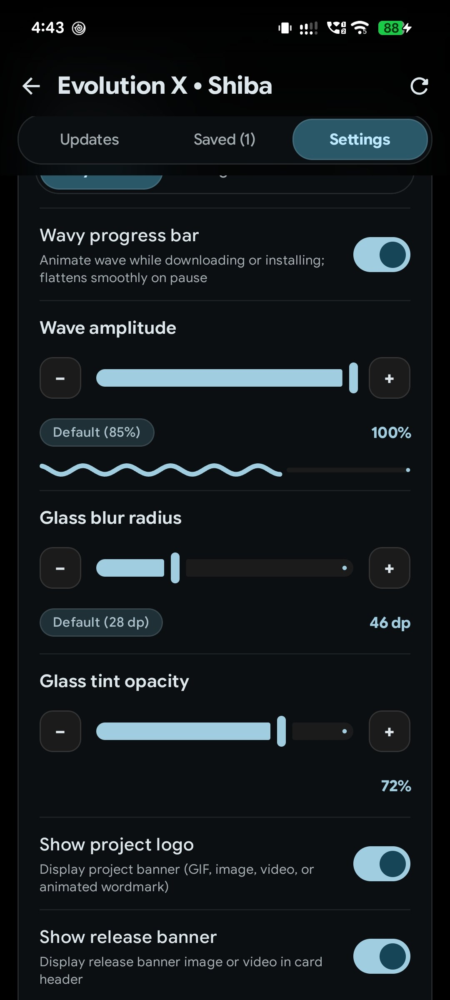 |
| Settings: background sync and verification | Saved tab: downloaded build, Install (Recovery) | Settings: wavy progress, glass blur/tint sliders |
| 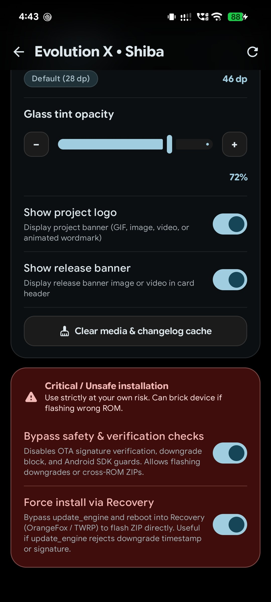 | 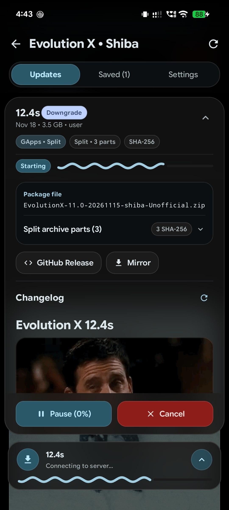 | 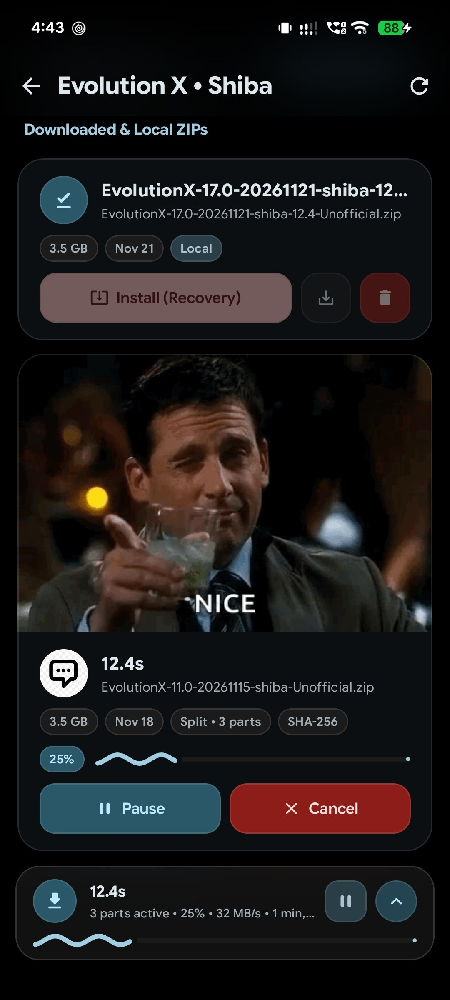 |
| Settings: danger zone (Unsafe Mode) | Active download, pause/cancel, floating bar | Parallel split download with float bar |
| 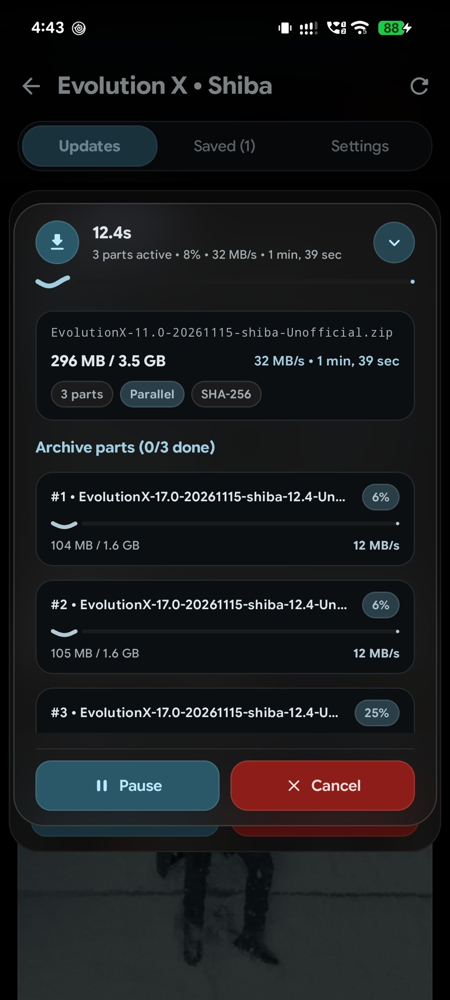 | 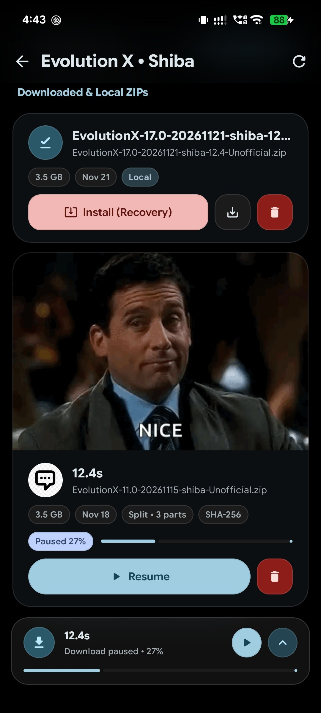 | 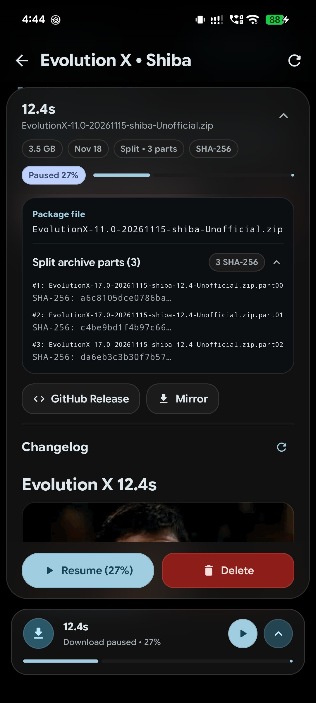 |
| Per-part progress (parallel workers) | Paused download with resume | Resume/Delete actions, mini player bar |

</details>

---

## 1. ROM Build Integration

Include the makefile once in your device tree (e.g., `device.mk` or `BoardConfig.mk`):

```makefile
-include packages/apps/LeeGarUpdater/LeeGarUpdater.mk
```

Including `LeeGarUpdater.mk` automatically:
1. Adds `LeeGarUpdater` to `PRODUCT_PACKAGES` (replacing stock `Updater` and `SystemUpdater` via Soong `overrides`).
2. Appends `packages/apps/LeeGarUpdater/sepolicy/private` to `SYSTEM_EXT_PRIVATE_SEPOLICY_DIRS`, labeling `/data/lgu_updates(/.*)?` as `u:object_r:ota_package_file:s0` so `update_engine` and recovery retain access.
3. Pulls `init.leegarupdater.rc` (creates `/data/lgu_updates 0770 system cache encryption=Require`), `org.leegar.updater.xml` (privapp permissions), and `default-permissions_org.leegar.updater.xml` via Soong `required` dependencies.

---

## 2. OTA Feed URL Resolution

The feed URL is resolved in the following priority order:

1. **Custom OTA URL** set by the user in Settings (or overlaid via `R.string.def_custom_ota_url`).
2. **System property** `lgu.updater.uri`.
3. **Overlayable string resource** `R.string.updater_server_url`, where `{device}` is replaced by the resolved device codename.

Device codename resolution order:
`ro.lgu.next_device` → `ro.leegar.device` → `ro.product.device` → `Build.DEVICE`.

### HTTP & Parser Behavior
* Requests are sent with `Cache-Control: no-cache`, 10s connect timeout, 15s call timeout, and automatic HTTP/HTTPS redirect following.
* Parsed with `kotlinx.serialization.json.Json` configured with `ignoreUnknownKeys = true`, `isLenient = true`, and `coerceInputValues = true` (unknown fields are safely ignored).
* Rate limits (`HTTP 429` or `HTTP 403` with `X-RateLimit-Remaining: 0` / rate-limit response body) and HTTP errors (`401`, `403`, `404`, `410`, `5xx`) are formatted into human-readable messages with retry wait hints from `Retry-After` or `X-RateLimit-Reset` / `RateLimit-Reset`.

### 2.1. Overriding URLs via Device Tree RRO

Instead of patching `LeeGarUpdater` directly, you can override `updater_server_url` and `menu_changelog_url` from your device tree using a static **Runtime Resource Overlay (RRO)** targeting `org.leegar.updater`.

#### Overlay Directory Structure

```text
device/<vendor>/<device>/overlay/UpdaterOverlayCustom/
├── Android.bp
├── AndroidManifest.xml
└── res/
    └── values/
        └── strings.xml
```

#### `Android.bp`

```bp
runtime_resource_overlay {
    name: "UpdaterOverlayCustom",
    theme: "UpdaterOverlayCustom",
    certificate: "platform",
    sdk_version: "current",
    product_specific: true,
    aaptflags: ["--keep-raw-values"],
}
```

#### `AndroidManifest.xml`

```xml
<?xml version="1.0" encoding="utf-8"?>
<manifest xmlns:android="http://schemas.android.com/apk/res/android"
    package="org.leegar.updater.custom.overlay">

    <overlay
        android:targetPackage="org.leegar.updater"
        android:priority="1000"
        android:isStatic="true" />
</manifest>
```

#### `res/values/strings.xml`

```xml
<?xml version="1.0" encoding="utf-8"?>
<resources xmlns:xliff="urn:oasis:names:tc:xliff:document:1.2">
    <!-- Uses literal {device} placeholder -->
    <string name="updater_server_url" translatable="false">https://example.com/OTA/{device}.json</string>

    <!-- Fallback changelog URL: uses Android format specifier %1$s -->
    <string name="menu_changelog_url" translatable="false">https://example.com/OTA/changelogs/%1$s.md</string>
</resources>
```

> **Placeholder note:** `updater_server_url` performs a literal `{device}` replacement, whereas `menu_changelog_url` is formatted via `Resources.getString(resId, device)` and expects `%1$s`.

#### Registering the Overlay in `device.mk`

Add the overlay module name to `PRODUCT_PACKAGES`:

```makefile
PRODUCT_PACKAGES += \
    UpdaterOverlayCustom
```

*(Optional)* You can also override default settings (such as `def_wavy_progress`, `def_blur_radius_dp`, `def_parallel_split_download`, `def_theme_mode`, etc.) by adding `res/values/config.xml` to the same RRO.

---

## 3. Root JSON Schema

```json
{
  "project": { ... },
  "response": [ ... ]
}
```

| Field | Type | Required | Description |
| :--- | :--- | :--- | :--- |
| `project` | `Object` | No | Global ROM/project header metadata displayed on the Hero Card. |
| `response` | `Array<Object>` | Conditional | Ordered list of release items (standard OTA format). |
| `items` | `Array<Object>` | Conditional | Alternative alias for `response`. Used only if `response` is `null`/omitted (`response ?: items ?: []`). |

---

## 4. `project` Object Reference

Controls the Hero Card at the top of the **Updates** tab and the top bar title.

| Field | Type | Description |
| :--- | :--- | :--- |
| `name` | `String` | Project display name (shown in the app bar and Hero Card). Falls back to `R.string.display_name`. |
| `tagline` | `String` | Short subtitle under the project name. If omitted, dynamically shows the count of newer/available builds or Android version + device codename. |
| `description` | `String` | Full Markdown description (supports headings, lists, links, code blocks, quotes, and inline images). |
| `logo` | `Object` | Structured logo descriptor (see below). If omitted or failed to load, falls back to the built-in animated `LeeGarLogoGlow` vector wordmark. |
| `logo_url` | `String` | Legacy/shorthand logo URL used when `logo` object is not provided. |
| `logo_type` | `String` | Shorthand type paired with `logo_url` (defaults to `"auto"`). |
| `maintainer` | `String` | Maintainer name. Falls back to the newest release's `maintainer`, then the first release's `maintainer`. |
| `links` | `Array<Object>` | Action link pills shown in the Hero Card (see `ProjectLink` below). If empty, automatically synthesized from legacy per-release fields (`forum`, `github`, `firmware`, `paypal`). |

### `project.logo` Object

| Field | Type | Default | Description |
| :--- | :--- | :--- | :--- |
| `url` | `String` | *(required)* | Direct URL to PNG, JPG, WebP (static or animated), GIF (with alpha), MP4, WebM, or MKV. |
| `type` | `String` | `"auto"` | `"auto"`, `"image"`, `"gif"`, `"png"`, `"webp"`, `"video"`, `"mp4"`, or `"webm"`. In `"auto"` mode, `.mp4`, `.webm`, and `.mkv` URLs are played as silent looping video via `MediaPlayer` + `TextureView`. |
| `aspect_ratio` | `Float` | `3.2` | Placeholder/fallback width-to-height ratio (clamped to `0.4..8.0`). Once loaded, the image or video's natural aspect ratio is used automatically. |
| `loop` | `Boolean` | `true` | Whether video logos loop continuously. |

### `links[]` (`ProjectLink`) Object

Used in both `project.links` and per-release `response[].links`. Entries with a blank `title` or `url` are skipped.

| Field | Type | Description |
| :--- | :--- | :--- |
| `title` | `String` | Button label. |
| `url` | `String` | Target URI opened via `ACTION_VIEW`. |
| `icon` | `String` | Optional icon keyword (case-insensitive): |

**Supported `icon` keywords:**
* `forum`, `xda`, `4pda` → Forum icon
* `firmware`, `download`, `mirror` → Download icon
* `donate`, `paypal`, `favorite`, `sponsor` → Heart/Donate icon
* `telegram`, `chat` → Send/Telegram icon
* `github`, `source`, `code` → Code icon
* `device`, `kernel` → Chip/Memory icon
* `web`, `site` → Globe/Web icon
* *(any other / omitted)* → Open-in-new icon

---

## 5. Release Item Schema (`response[]` / `items[]`)

| Field | Type | Required | Description |
| :--- | :--- | :--- | :--- |
| `filename` | `String` | **Yes** | Target archive filename (e.g. `LGU-11.0-20261115-shiba.zip`). |
| `id` | `String` | No | Unique identifier for this build. Fallback priority: `id` → `sha256` → `"<filename>_<timestamp>"`. Duplicates in the same feed are auto-suffixed with `_<index>`. |
| `version` | `String` | No | Build version title displayed on the release card (falls back to `filename`). |
| `timestamp` | `Long` | No | Build timestamp in **UNIX seconds** (UTC). Compared against `ro.build.date.utc` to classify builds as **Newer**, **Installed**, or **Downgrade**. |
| `buildtype` | `String` | No | Build channel/type label (e.g. `Official`, `Unofficial`, `Beta`). |
| `tag` | `String` | No | Accent badge pill displayed on the release card (e.g. `Latest`, `GApps`, `Vanilla`). |
| `size` | `Long` | No | Total archive size in bytes. If `0` or omitted, automatically computed as the sum of `parts[].size` when every part declares a size. |
| `sha256` | `String` | No | Expected SHA-256 hex digest of the final assembled archive. Checked automatically when hash verification is enabled in Settings. |
| `download` | `String` | No | Direct single-file download URL, **or** newline-separated (`\n`) URLs for legacy split archives. Ignored if `parts` is non-empty. |
| `parts` | `Array<String \| Object>` | No | Multi-part split archive definition (see Section 6). Takes precedence over `download`. |
| `os_patch_level` | `String` | No | Security patch date string (e.g. `"2026-11-05"`). |
| `os_sdk_level` | `Int` | No | Target Android API level (defaults to the device's current `Build.VERSION.SDK_INT` if omitted). Used for major upgrade / downgrade blocking. |
| `ota_property_files` | `String` | No | Byte-range map for A/B streaming installation (see Section 7). |
| `changelog` | `String` | No | Inline Markdown changelog (highest priority). |
| `changelog_url` | `String` | No | URL to a raw Markdown changelog file (used when `changelog` is blank). |
| `banner` | `String \| Object` | No | Release card header banner (image, GIF, video, SVG/Vector XML, pathData, or JSON object — see Section 8). |
| `ico_banner` | `String \| Object` | No | Custom circular icon (44dp) for the release card. Supports the exact same formats as `banner`. |
| `links` | `Array<ProjectLink>` | No | Per-release link pills displayed inside the expanded release modal. |
| `maintainer` | `String` | No | Legacy fallback for `project.maintainer`. |
| `forum` | `String` | No | Legacy fallback link (mapped with `icon: "forum"`). |
| `github` | `String` | No | Legacy fallback link (if not starting with `http://`/`https://`, prefixed with `R.string.link_github_prefix`). |
| `firmware` | `String` | No | Legacy fallback link (mapped with `icon: "firmware"`). |
| `paypal` | `String` | No | Legacy fallback link (mapped with `icon: "donate"`). |

---

## 6. Split / Multi-Part Downloads (`parts`)

`parts` uses a polymorphic serializer (`UpdatePartSerializer`) so each entry can be either a **plain URL string** or a **structured object**:

```json
"parts": [
  "https://example.com/builds/rom.zip.001",
  {
    "url": "https://example.com/builds/rom.zip.002",
    "size": 1073741824,
    "sha256": "e3b0c44298fc1c149afbf4c8996fb92427ae41e4649b934ca495991b7852b855"
  }
]
```

* **Resumable parts:** Parts are stored temporarily under `/data/lgu_updates/.parts/<downloadId>/` as `part_001.bin` with `.done` completion markers.
* **Parallel or sequential:** Downloads run sequentially or with up to 3 parallel workers depending on the user's **Parallel split download** setting.
* **Automatic size discovery:** If `size` is omitted on a part, the client probes `HEAD` (`Content-Length`) and falls back to `Range: bytes=0-0` (`Content-Range`).
* **Hash verification:** If hash verification is enabled, each part with a `sha256` is verified right after download (retrying up to 3 times on mismatch), and the final merged archive is verified against the release's top-level `sha256`.
* **Legacy newline syntax:** Placing multiple URLs separated by `\n` inside `"download"` also triggers split mode automatically.

---

## 7. A/B Streaming (`ota_property_files`)

To allow `update_engine` to stream the OTA directly without saving the full ZIP first, provide comma-separated `filename:offset:size` tokens (matching AOSP's `ota_property_files` metadata):

```json
"ota_property_files": "payload_metadata.bin:4718:221306,payload.bin:4718:3488842185,payload_properties.txt:3488846958:156"
```

Streaming is enabled only when **all** conditions are met:
1. Device is A/B (`ro.build.ab_update=true`).
2. User enabled **Stream updates** in Settings and **Force Recovery Install** is off.
3. The build is a single-file online package (not split and not already downloaded locally).
4. Both `payload.bin` and `payload_properties.txt` offsets and sizes are present in `ota_property_files`.

---

## 8. Flexible Media & Vector Specs (`banner` & `ico_banner`)

Both `banner` and `ico_banner` accept either a JSON string or a JSON object (`FlexibleMediaStringSerializer`). Supported formats:

1. **Direct media URL (image / animated GIF / animated WebP / MP4 / WebM / MKV):**
   ```json
   "banner": "https://example.com/banners/v11.webp"
   ```
2. **Structured media object:**
   ```json
   "banner": {
     "url": "https://example.com/banners/v11.mp4",
     "type": "video",
     "loop": true
   }
   ```
3. **Inline SVG or Android VectorDrawable XML:**
   ```json
   "ico_banner": "<svg viewBox=\"0 0 24 24\"><path d=\"M12 2L2 22h20z\"/></svg>"
   ```
   *(Also accepts `<vector viewportWidth="24" viewportHeight="24"><path pathData="..."/></vector>`.)*
4. **Vector JSON object:**
   ```json
   "ico_banner": {
     "path": "M12 2L2 22h20z",
     "viewportWidth": 24,
     "viewportHeight": 24
   }
   ```
   *(Also accepts keys `pathData`, `d`, `svg`, or `vector`.)*
5. **Prefixed or raw SVG pathData:**
   ```json
   "ico_banner": "vector:M12 2L2 22h20z"
   ```
   or raw path data starting with `M`/`m`. Vectors are automatically tinted to the Material You theme color.

### Markdown Banner Fallback
If `banner` is omitted on a release, the app scans the release's `changelog` (inline or loaded from `changelog_url`) for the first Markdown image whose alt text contains the word `banner` (case-insensitive):

```markdown

```

---

## 9. Ordering, Changelogs & Caching Behavior

* **Order preservation:** Release cards are displayed strictly in the order they appear in the JSON array (`order_index ASC, timestamp DESC`), allowing pinned/featured builds at the top regardless of timestamp.
* **Local state preservation:** Refreshing the feed updates metadata for existing builds while preserving downloaded files and persistent statuses (`PAUSED`, `VERIFIED`, `UPDATED_NEED_REBOOT`). Stale un-downloaded online entries removed from the feed are pruned; local imported ZIPs and downloaded packages are never deleted by a feed refresh.
* **Changelog resolution order:**
  1. Inline `changelog` field from JSON.
  2. Disk/memory cache (`cacheDir/updater_changelogs/`).
  3. Remote `changelog_url` from JSON.
  4. Fallback URL template `R.string.menu_changelog_url` formatted with the device codename.
* **Cache refresh policy:** Images, videos, and changelogs are cached on disk (`cacheDir/updater_media/` and `cacheDir/updater_changelogs/`) and are only refreshed when:
  * The user taps **Refresh / Check for updates** (or reloads a changelog manually),
  * The background `UpdatesCheckWorker` runs, or
  * First-ever launch when no updates have ever been fetched.

---

## 10. Complete Example JSON

### Full Modern Feed
```json
{
  "project": {
    "name": "LeeGar ROM",
    "tagline": "Monthly security & feature builds",
    "description": "Official OTA feed for **Pixel 8 (shiba)**.\n\n- Built with custom kernel\n- Verified SHA-256 packages",
    "logo": {
      "url": "https://example.com/assets/logo.webp",
      "type": "auto",
      "aspect_ratio": 3.5,
      "loop": true
    },
    "maintainer": "LeeGar",
    "links": [
      { "title": "Telegram", "url": "https://example.com/tg", "icon": "telegram" },
      { "title": "GitHub", "url": "https://example.com/github", "icon": "github" },
      { "title": "Forum", "url": "https://example.com/forum", "icon": "forum" },
      { "title": "Donate", "url": "https://example.com/donate", "icon": "donate" }
    ]
  },
  "response": [
    {
      "id": "lgu-11.0-20261115-shiba",
      "version": "11.0",
      "buildtype": "Official",
      "tag": "Latest",
      "filename": "LGU-11.0-20261115-shiba.zip",
      "timestamp": 1794774932,
      "size": 3488842185,
      "os_patch_level": "2026-11-05",
      "os_sdk_level": 36,
      "sha256": "0c93af1aa44b563b5687344984b4aa754ae77705b21d9d28c87af3d43d6bfcaa",
      "parts": [
        {
          "url": "https://example.com/builds/LGU-11.0-20261115-shiba.zip.001",
          "size": 1744421092,
          "sha256": "1111111111111111111111111111111111111111111111111111111111111111"
        },
        {
          "url": "https://example.com/builds/LGU-11.0-20261115-shiba.zip.002",
          "size": 1744421093,
          "sha256": "2222222222222222222222222222222222222222222222222222222222222222"
        }
      ],
      "banner": "https://example.com/banners/v11.webp",
      "ico_banner": "vector:M12 2L2 22h20z",
      "changelog_url": "https://example.com/changelogs/20261115.md",
      "links": [
        { "title": "Mirror", "url": "https://example.com/mirror", "icon": "mirror" },
        { "title": "Firmware", "url": "https://example.com/firmware", "icon": "firmware" }
      ]
    },
    {
      "version": "10.9",
      "buildtype": "Official",
      "filename": "LGU-10.9-20261015-shiba.zip",
      "timestamp": 1792100000,
      "size": 3100000000,
      "download": "https://example.com/builds/LGU-10.9-20261015-shiba.zip",
      "ota_property_files": "payload_metadata.bin:4718:221306,payload.bin:4718:3099000000,payload_properties.txt:3099004800:156",
      "changelog": "## Highlights\n- October security patch\n- Stability improvements"
    }
  ]
}
```

### Minimal Legacy Feed (Still Supported)
```json
{
  "response": [
    {
      "filename": "LGU-11.0-20261115-shiba.zip",
      "download": "https://example.com/builds/LGU-11.0-20261115-shiba.zip",
      "timestamp": 1794774932,
      "size": 3488842185,
      "version": "11.0",
      "buildtype": "Official",
      "maintainer": "LeeGar",
      "forum": "https://example.com/forum",
      "github": "leegar-org"
    }
  ]
}
```

---

## 11. Runtime System Properties

| Property | Type | Description |
| :--- | :--- | :--- |
| `lgu.updater.uri` | `String` | Overrides the default `R.string.updater_server_url` feed URL. |
| `ro.lgu.next_device` | `String` | Highest-priority device codename override for `{device}` substitution. |
| `ro.leegar.device` | `String` | Primary ROM device codename property (falls back to `ro.product.device` / `Build.DEVICE`). |
| `lgu.updater.allow_downgrading` | `Boolean` | Allows installing builds with an older timestamp or lower SDK level without Unsafe Mode. |
| `lgu.updater.allow_major_upgrades` | `Boolean` | Allows installing builds targeting a higher `os_sdk_level` without Unsafe Mode. |
| `persist.vendor.recovery_update` | `Boolean` | Toggled by the "Update recovery" setting when `/vendor/bin/install-recovery.sh` exists. |
